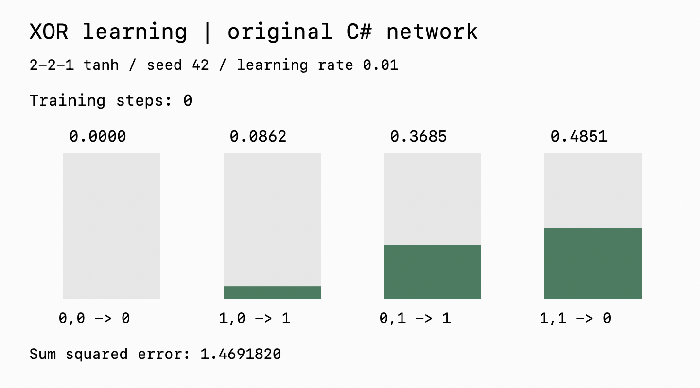

# Neural Network from Scratch

I implemented a feedforward neural network in C#, including neurons, weighted connections, activation functions, and backpropagation. The console example learns XOR; a separate Windows Forms example draws a learned approximation of a sine wave.

## Recorded learning run



I recorded this run using the original network implementation, with seed `42`, a **2 → 2 → 1** tanh network, and learning rate `0.01`. After 100,000 full-dataset training steps, predictions were approximately `0.000051, 0.994514, 0.994524, 0.000069` for inputs `00, 10, 01, 11`. The final sum of squared errors was `0.00006009`.

The animation shows actual predictions sampled every 1,000 steps. Bar heights are clipped to the display range 0–1; the numbers show the raw predictions. It is a separate visualization of a recorded run, not a recording of the Windows application. XOR is a four-example training task, so these results are not a generalization benchmark. The full measurements are in [xor-training.csv](docs/xor-training.csv).

Reproduce the bounded capture without changing the core algorithm:

```sh
dotnet build tools/CaptureXor/CaptureXor.csproj
dotnet tools/CaptureXor/bin/Debug/net6.0/CaptureXor.dll > docs/xor-training.csv
```

The capture project links the existing C# implementation and replaces only the interactive console loop. Optional animation rendering uses macOS AppKit through Swift and FFmpeg, which were already installed on the recording machine. These tools are not needed to run the network:

```sh
swift tools/CaptureXor/render.swift docs/xor-training.csv /tmp/xor-frames
ffmpeg -framerate 10 -i /tmp/xor-frames/frame-%03d.png -vf 'split[a][b];[a]palettegen[p];[b][p]paletteuse' -loop 0 docs/xor-learning.gif
```

## A local XOR example

The console example uses a **2 → 2 → 1** network, `tanh` activations, squared error, and a learning rate of `0.01`.

| Input | XOR target | Observed output |
| --- | --- | --- |
| `(0, 0)` | 0 | 0.000 |
| `(0, 1)` | 1 | 0.997 |
| `(1, 0)` | 1 | 0.997 |
| `(1, 1)` | 0 | 0.000 |

These are rounded values from one short local run of the original console program. Initialization is random, so this is an example rather than a repeatability or accuracy claim. The console rounds its error display; `0` there does not imply mathematically zero loss. The observed values are also in [CSV form](docs/xor-example.csv).

## Run the console example

The console project targets **.NET 6** and declares no third-party package dependencies. Run this project directly rather than building the whole solution, which also contains Windows GUI projects.

```sh
dotnet run --project "NeuralNetwork/NeuralNetwork.csproj" -c Release
```

The program continuously trains and refreshes the four outputs. Press **Ctrl+C** to stop. Both the Release build and this console training loop were checked locally on macOS.

## Sine-wave visualization

`GraphSin` is a Windows Forms project targeting `net6.0-windows`. It trains a **1 → 10 → 10 → 10 → 10 → 1** network against 70 sine samples and draws predictions on a timer.

On Windows with the matching .NET desktop tooling:

```sh
dotnet run --project "GraphSin/GraphSin.csproj" -c Release
```

This UI was inspected in source, not rerun on Windows. The older `Graph/` application also targets the Windows desktop and .NET Framework.

## Implementation

| File in `NeuralNetwork/` | Responsibility |
| --- | --- |
| `NeuralNet.cs` | Forward pass, error calculation, training loop |
| `Layer.cs` | Layer operations and outputs |
| `Neuron.cs`, `Dendrite.cs` | Activations, deltas, connection updates |
| `ActivationFunction.cs` | Activation and error functions |
| `GeneticAlgorithm.cs` | Separate crossover/mutation experiments |
| `Program.cs` | XOR example |

The sine example currently uses gradient descent; its genetic-learning loop is commented out. This repository is an experiment, without model serialization, automated gradient checks, or a benchmark suite.
